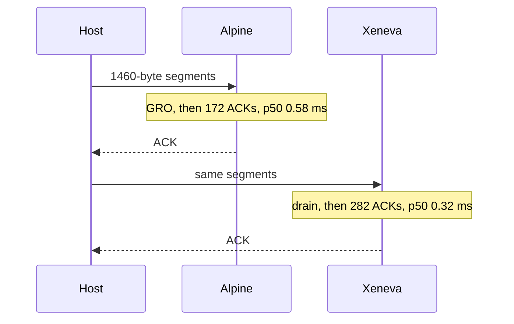

# TCP throughput

XenevaOS against Alpine Linux, both AArch64 guests on the same QEMU machine. The guest under test is the whole system: sockets, TCP, the virtio-net driver, the copy path, and loopback. Three rounds, five reps, 8 MiB host to guest, plus a 1 MiB loopback transfer. Socket suite 337 pass, 0 fail, 0 skip.

## Host

AMD Ryzen 7 5800HS, 8 cores / 16 threads, boost 4465 MHz. L1 32+32 KiB, L2 512 KiB, L3 16 MiB. 15 GiB RAM. Linux 7.2.9-zen. QEMU 11.1.2, `virt` + `cortex-a72`, 1024 MiB, virtio-net-pci, slirp `10.0.2.0/24`. Load during the runs sat around 2 to 3.

Alpine in the guest is 3.22.2, Linux 6.12.51-virt, CPU part `0xd08`, 962 MiB, `eth0` 10.0.2.15/24, `pfifo_fast`. `tcp_rmem` 4096 / 131072 / 6291456, `rmem_max` 212992.

Loopback copies the user bytes into the peer receive buffer inside `AuTCPSend` and treats them as already acknowledged: no IP header, no checksum, no second trip through the stack. Virtio negotiates `VIRTIO_NET_F_GUEST_TSO4` and posts 64 KiB receive buffers, so a device can hand TCP one large segment instead of a string of 1460-byte frames.

## Host to guest

| Sample | XenevaOS | Alpine | Delta |
| --- | ---: | ---: | ---: |
| First | 109600 KiB/s | 95300 KiB/s | +15% |
| Second | 108700 KiB/s | 97000 KiB/s | +12% |

The guest is the receiver. The host writes 8 MiB to port 9000 and slirp sends it as 1460-byte segments. Both stacks see the same wire.

### What the driver does with a burst

`AuVirtioNetInitialize` negotiates `VIRTIO_NET_F_MAC` and nothing else. There is no mergeable RX buffer, no guest checksum, and no GSO. Each used-ring entry is one Ethernet frame. `AuVirtioNetRxPoll` sets `VIRTQ_AVAIL_F_NO_INTERRUPT` for the pass, invalidates the buffer, and hands the frame to `AuEthernetHandle`. The buffer goes straight back on the available ring. When the used index catches up, the driver clears the flag and looks once more, so a completion that landed while the flag was being cleared is still taken in this pass. One invocation stops after `2 * rx_qsize` buffers, so a full queue cannot sit in the interrupt handler.

The interrupt handler does not call the driver directly. It calls `AuNetRxPoll`. That counter is what makes the ACK batch safe: a nested poll, such as `recv` polling while the interrupt drain is already running, must not send the ACK before the ring is empty. Only the outermost return flushes.

TX completions share MSI-X vector 0 with RX. The TX available ring is created with `VIRTQ_AVAIL_F_NO_INTERRUPT`, and `AuVirtioTransmit` frees slots by reading `tx_used->idx`. An ACK no longer raises that shared interrupt. The transmit slot used to be zeroed for all 2 KiB. Only the 12-byte virtio-net header is cleared now. The frame bytes are overwritten by the copy. `gso_type` stays `VIRTIO_NET_HDR_GSO_NONE`.

Linux `virtnet_poll` is NAPI with a budget of 64. It turns the callback off, pulls buffers, and feeds them to `napi_gro_receive`. GRO can merge several 1460-byte frames into one socket buffer before TCP runs. Checksum verification can happen in the device. That is fewer trips into TCP. It is also more work on every burst: feature negotiation, GRO hashing, the qdisc, and the rest of the receive softirq.

### What TCP does with each segment

A full-sized segment (`payload >= MSS/2`) increments `ack_pending`. Once two such segments are outstanding, `TCPDeferAck` links the control block on `tcp_ack_head` and does not transmit. A short segment, a gap, a buffer that cannot hold the payload, and FIN still call `TCPSendAck` immediately, so an interactive peer is not left waiting for a second segment.

`AuTCPFlushDeferredAcks` walks that list when the outermost drain returns. One slirp burst then produces one ACK for the drain, and every ACK carries the current window. `AuTCPReceive` also flushes a held ACK after it copies bytes out. If free space was under two MSS and the read opened it, the same ACK is a window update, so the sender learns the buffer has room without waiting for the next data segment.

The receive buffer is 256 KiB. `kmalloc` grows the kernel heap by enough pages to satisfy that allocation. The SYN offers an MSS option and RFC 7323 scale 3, which would let the 16-bit window field advertise the whole buffer. On this slirp path the SYN-ACK comes back with no scale and no SACK, so the field on the wire is 65535 for both guests. The extra buffer is room for the copy. It is not a larger advertisement than Linux in this run.

Kernel `memcpy` and the user-side copy in XEClib move 32 bytes per step after the destination is aligned, then 8, then the tail. A 1460-byte payload is not a byte loop on either side of `recv`. The TCP checksum is still a software sum. Linux can skip that sum in the device and still lose, because the rest of its receive path is the larger cost.

A raw socket is capped at 64 queued frames. A tap is an observer. Without the cap it used to enqueue every frame of a fast receive until the heap grew, and that growth became part of the benchmark.

### What the capture says

One 8 MiB connection per guest. `filter-dump` is on for this pass only, so its rate is not the score in the table above.

| | XenevaOS | Alpine |
| --- | ---: | ---: |
| Pure guest ACKs | 282 | 172 |
| Bytes per ACK | 29747 | 48771 |
| ACK latency p50 | 0.324 ms | 0.583 ms |
| ACK latency p90 | 0.611 ms | 1.026 ms |
| ACK latency max | 6.706 ms | 6.827 ms |
| Gaps over 0.4 ms | 78 | 128 |
| Time in those gaps | 68.6 ms | 87.2 ms |
| Data packets | 5826 | 5832 |
| Advertised window | 65535 | 65535 |
| MSS, both directions | 1460 | 1460 |
| Retransmits | 0 | 0 |

Data packets match, so both guests are looking at the same segments. Alpine sends 172 ACKs covering 48771 bytes each. Xeneva sends 282 ACKs covering 29747 bytes each. GRO is why Linux covers more bytes with one ACK: TCP sees one merged buffer and acknowledges that, while the pcap still counts every frame on the wire.

Xeneva is faster because the guest returns the ACK sooner and stalls less. p50 is 0.324 ms against 0.583 ms. p90 is 0.611 ms against 1.026 ms. Gaps over 0.4 ms are 78 against 128, and those gaps add up to 68.6 ms against 87.2 ms. The host's send window moves when the ACK arrives. A quicker ACK, from a drain that did not take an interrupt per buffer and did not transmit until the ring was empty, is the +15% and +12%.



## Loopback

1 MiB stays inside the guest. Nothing in this test crosses virtio or slirp.

`TCP_MSS_LOOPBACK` is 32768, chosen because one test chunk fits the receive buffer. A loopback peer, and any address `AuAddrIsLocal4` or `AuAddrIsLocal6` treats as local, gets that MSS. Ethernet stays at 1460. The SYN carries the larger MSS, so each `send` is one segment of up to 32 KiB instead of a string of 1460-byte segments.

`IPv4SendPacket` checks the device. For `lo`, or for a destination that is local, it runs the netfilter output hooks and then calls `IPv4HandlePacket` before returning. TCP input, the copy into the receive buffer, and the wake of the reader all happen inside the sender's call. The sequence number is advanced before that handoff. Loopback delivery is inline, and an ACK generated from inside that call would otherwise look out of window.

`AuEthernetSend` returns immediately on a loopback device. For an established connection, `TCPLoopbackPush` does not call it at all. The send copies into the peer's receive buffer, advances both sequence numbers, marks the bytes acknowledged, and wakes the reader. When the reader drains, it wakes the sender. The handshake still builds a normal SYN.

Alpine still walks its full stack. The segment goes down through TCP, IP, and the qdisc, into the loopback driver, then up through a softirq into IP and TCP again. That second trip happens once per segment. Xeneva pays for one copy from the sender's buffer into the receiver's buffer. That is the loopback gap.

| Round | XenevaOS | Alpine client | Xeneva / Alpine |
| --- | ---: | ---: | ---: |
| 1 | 172671 KiB/s | 57557 KiB/s | 3.0x |
| 2 | 122333 KiB/s | 48933 KiB/s | 2.5x |
| 3 | 155362 KiB/s | 77681 KiB/s | 2.0x |

```bash
python3 Tests/netbench/netbench.py --reps 5 --rounds 3 --no-pcap
python3 Tests/netbench/netbench.py --reps 5 --rounds 3 --pcap
```
